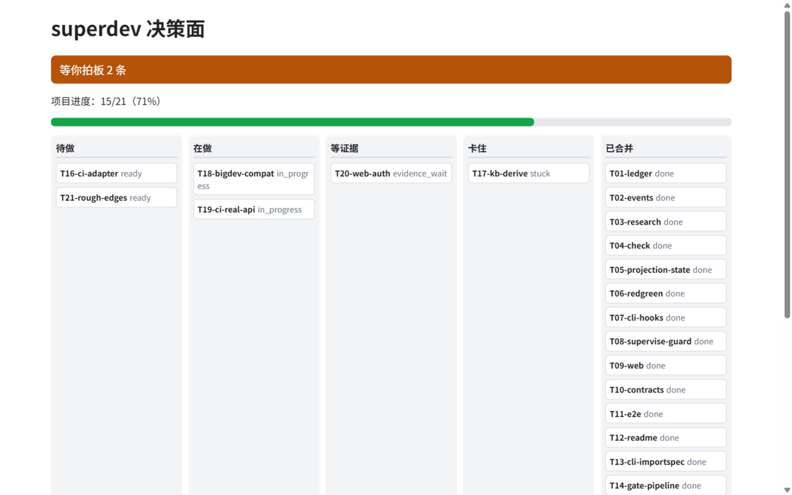

# superdev

**Other tools assign work to AI agents. superdev makes it land green.**

[](https://github.com/yinrong/superdev/actions/workflows/tests.yml)
[](LICENSE)
[](pyproject.toml)
[](tests/)

superdev is an execution-reliability layer for AI coding teams: an open-source control tower that turns a fleet of coding agents (Claude Code, Codex, ZCode, Kimi, ...) into workers that actually finish — tests passing, MR opened, evidence attached — without a human babysitting the loop.

**English** · [简体中文](README.zh-CN.md) · [Design docs](design/README.md)

## Watch it work — 15 seconds, no API key

The failure lifecycle is the whole product. Watch one task go red, roll back, get forced into research, go green, merge — and a second task get stuck, escalated, and decided by a human click:

```bash
python examples/see_failure_lifecycle.py
```

```
[RED] login regression verdict: RED (failure log tail fed back)
[ROLLBACK] hard reset to green base, failure log fed to next attempt
[RESEARCH] 2nd red triggers research: a direction change must cite research
[GREEN] login regression verdict: GREEN (commit fake-003)
[ALL_GREEN] fix-login-bug: gating → merged — even green must pass the gate to merge
...
[VERDICT] Strategy change does not cite research → no 3rd blind retry, stuck stops spinning
[TASK_STUCK] refactor-api: in_progress → stuck
[VERIFY] EventLog.verify(): 11 events, hash chain intact — nobody can tamper with this decision chain
Demo complete: green never merges without gating, stuck never spins idle
```

## The problem it kills

If you run multiple coding agents, you have met this wall:

- An agent edits until tests fail, then keeps editing the broken tree. Every retry drifts further from green.
- The same strategy gets retried five times. Tokens burn. Progress is zero.
- A human finds out hours later, reads a chat log, and guesses what was already tried.

Most tools treat these as exceptions. superdev treats failure as a **first-class lifecycle**:

```
task starts ──▶ research budget (by task size)
                 │
                 ▼
       ┌── red-green loop ──────────────┐
       │  start from last-green commit  │
       │  red → roll back, feed logs    │
       │  2nd red → forced research,    │
       │           strategy must cite   │
       │           findings, or stop    │
       └──────────────┬─────────────────┘
                      ▼
   green? ─▶ review ─▶ quality gate ─▶ merge & sync back
   stuck? ─▶ structured report ("what we tried") ─▶ one-click human decision ─▶ auto-resume
```

Nothing lands red. Nothing spins silently. Every dead end is documented before a human is asked.

## 60-second quickstart

```bash
git clone https://github.com/yinrong/superdev
cd superdev
pip install -e ".[dev]"
python -m pytest -q          # 342 passed
```

Or use it as a library without cloning: `pip install "superdev @ git+https://github.com/yinrong/superdev"`

Then the self-hosting party trick — the repo validates its own development ledger:

```bash
python superdev_cli.py check agents/superdev-dev/plan.yml
# validation passed: 0 issues
python superdev_cli.py round agents/superdev-dev
# projection refreshed: 22 tasks
```

Import a spec-kit plan and run it as tracked tasks:

```bash
python superdev_cli.py import-spec <spec-dir> plan.yml
python superdev_cli.py check plan.yml
```

## What's inside

One module, one job — 17 modules, each with its own test file:

| Layer | Modules |
|---|---|
| Ledger & rules | `ledger` (git-versioned task ledger) · `check` (8-rule contract validator) · `hooks` (program-enforced boundaries) |
| Execution discipline | `redgreen` (green-point branching, rollback, 2-red research gate) · `research` (budget tiers + module knowledge base) · `engines` (pluggable worker adapters) |
| Flow & state | `state` (task state machine) · `events` (tamper-evident hash-chained log) · `projection` (SQLite read model) |
| Safety nets | `supervise` (stall detection, 5-part escalation reports, auto-resume) · `guard` (resource guard) · `gate` (lint/type/test/build pipeline) · `reviewer` (second-pair-of-eyes worker) · `ciadapter` (GitHub Actions / GitLab CI watchers) |
| Humans & input | `web` (kanban + one-click decision UI, token auth) · `clarify` (requirements clarifier) · `importspec` (spec-kit import) |

## How it compares

| Capability | superdev | spec-kit | Superpowers | Aider | Vibe Kanban |
|---|---|---|---|---|---|
| Failure lifecycle: budget → research → report → decision → auto-resume | ✔ | ✘ | ✘ | ✘ | ✘ |
| Red-green discipline enforced by code (not prompts) | ✔ | ✘ | partial (TDD gate) | ✔ (single session) | ✘ |
| Multi-repo task fanout, open source | ✔ | ✘ | ✘ | ✘ | ✘ |
| Engine-agnostic workers (any CLI agent) | ✔ | ✔ | ✘ | ✘ | ✔ |
| Event-driven state machine + web decision UI | ✔ | ✘ | ✘ | ✘ | ✘ |
| Self-hosting: repo built by its own pipeline | ✔ | partial | ✘ | ✘ | ✘ |
| Maintenance status | active | active | active | slowed (community fork) | sunset (2026-04) |

spec-kit plans the right thing; superdev lands it green. They compose: import a spec-kit plan, superdev runs it.

## Self-hosting proof

This repository was built by superdev itself, dogfooded end to end:

- **21 tasks** in a public ledger ([agents/superdev-dev/](agents/superdev-dev/plan.yml)), dispatched to **14 worker sessions**
- **8 green points**: every merge happened only after the full suite passed at a new high-water mark (59 → 143 → 223 → 239 → 310 → 342 tests)
- The contract validator (`check`) rejected this repo's own ledger twice during development — once for a file-boundary violation, once for over-parallel dispatch. Both were fixed through the rules, not around them.

## The decision board

Stalled work surfaces as a structured decision — failure case, what was tried, cost — and one click resumes the task. The board below is this repo's own ledger mid-development:



*(demo data; serve your own with `DecisionWeb(...).serve(port=8765, block=True)`)*

## Documentation

- [中文 README](README.zh-CN.md)
- [Design: positioning & selling points](design/01-positioning.md) · [architecture](design/02-architecture.md) · [detailed design](design/03-detailed-design.md) · [lessons from our predecessor](design/04-lessons-from-bigdev.md) · [competitive analysis](design/05-competitor-comparison.md)
- Contracts: [manager](commands/superdev-manage.md) · [worker](commands/superdev-work.md)

## Status & roadmap

v0.1 — core loop complete: ledger, red-green discipline, research budgets, event machine, supervision, decision UI, CI watchers, spec-kit import. 342 tests, zero known issues.

Roadmap (deliberately not in v0.1): cloud-synced kanban, pluggable edit engine, hosted offering.

## Contributing & license

If this kills a real pain for you, a ⭐ is the cheapest way to help others find it.

Tasks enter the ledger before code does — read [CONTRIBUTING.md](CONTRIBUTING.md) and the [worker contract](commands/superdev-work.md). All PRs must keep the suite green.

[Apache-2.0](LICENSE) © 2026 superdev contributors
